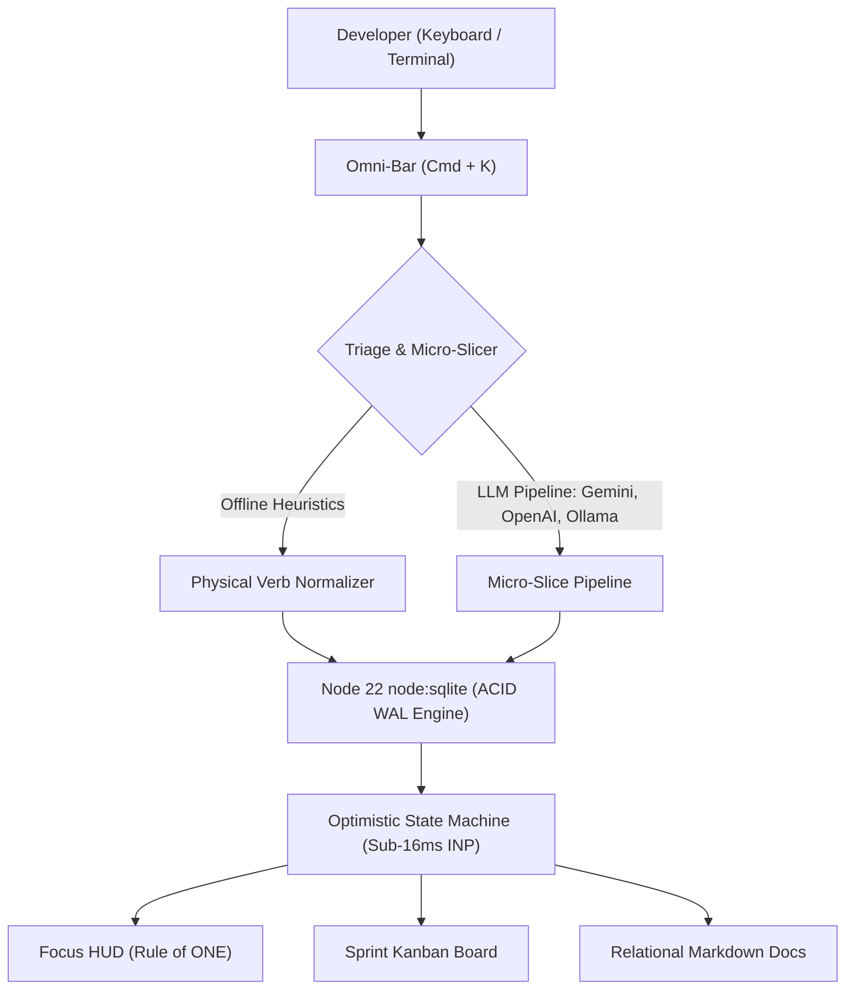

# Occurence

[](https://github.com/overduality/occurence/actions/workflows/ci.yml)
[](LICENSE)
[](https://nodejs.org/)
[](https://nextjs.org/)

**Occurence** is a high-performance developer execution HUD, relational document engine, and micro-slicing AI workspace engineered for low-friction software delivery. Built with Next.js 14 (App Router) and Node 22's native `node:sqlite` engine running synchronous Write-Ahead Logging (WAL) for sub-16ms INP interactions.

---

## Core Architecture & Engine

### 1. Ingestion & Micro-Slicing Pipeline (`Cmd + K`)
The global **Omni-Bar** captures raw engineering notes, bug reports, and PR requirements. The dual heuristic NLP & LLM triage pipeline slices input into:
- **Actionable Execution Steps:** 5–15 minute micro-actions starting with physical verbs (`Open...`, `Write...`, `Run...`) paired with a **2-Minute Kickstart**.
- **Micro-Sprints:** Decomposes multi-step epics into 3–5 active runway steps while parking overflow items into the backlog transactional vault.
- **Relational Markdown Pages:** Structured documentation pages, ADRs, and runbooks with one-click bidirectional task extraction.

### 2. The Rule-of-ONE Execution Engine (Focus HUD)
Eliminates backlog paralysis during heads-down coding sessions. The Focus HUD abstracts sprawling issue backlogs and surfaces **only the single active step**, its **2-Minute Kickstart**, interactive micro-checkpoints, and a multi-preset focus timer (`2m` / `10m` / `25m`) that automatically aggregates focus time into SQLite daily metrics.

### 3. Sprint Kanban & Issue Inspector (`E`)
- **Linear/Jira-Grade Issue Inspector:** Press `E` or click any card to inspect title, auto-sizing description, 2-minute kickstart, outcome, status, priority, time estimate, sprint assignment, and checkpoints. Convert any issue into a linked Markdown ADR with one click.
- **Dynamic Kanban Lanes:** Customizable WIP limits, stage colors, inline task creators, and reorderable lifecycle columns.

### 4. Relational Docs & Interactive Scratchpad
- **Interactive Markdown Pages:** Clickable `- [ ]` / `- [x]` checklists that mutate live Markdown content, GFM tables, code blocks, editable tags, word count, reading time, and 1-click engineering templates (*ADR*, *Runbook*, *Postmortem*).

### 5. Zero-Guilt Grounding Engine (`G`)
Press `G` or click **I'm Lost** when context-switching or facing cognitive fatigue. With zero lecturing, Occurence re-orients your workspace in **one calm sentence** and presents **one immediate 2-minute micro-action** to rebuild momentum.

---

## Architecture Flow



---

## Database Architecture: SQLite WAL Mode

Occurence utilizes Node's built-in `node:sqlite` engine (`DatabaseSync`) backed by persistent local storage in `./data/outterring.db`. Every connection initializes with high-concurrency ACID pragmas:

```sql
PRAGMA journal_mode = WAL;
PRAGMA synchronous = NORMAL;
PRAGMA busy_timeout = 5000;
PRAGMA foreign_keys = ON;
PRAGMA cache_size = -20000;
PRAGMA temp_store = MEMORY;
```

Persistent files in `./data/`:
- `data/outterring.db` — Primary relational database
- `data/outterring.db-wal` — Write-Ahead Log
- `data/outterring.db-shm` — Shared-memory index

---

## Keyboard Shortcuts

| Shortcut | Action |
| :--- | :--- |
| `Cmd + K` / `Ctrl + K` | Toggle Global Omni-Bar (Quick Capture & Search) |
| `Space` | Complete active Focus step & advance queue |
| `E` | Open Issue Inspector for active step |
| `1` | Switch to **Focus HUD** (Rule of ONE) |
| `2` | Switch to **Board** (Sprint Kanban) |
| `3` | Switch to **Docs** (Markdown Workspace) |
| `G` | Trigger **Grounding Anchor** ("I'm Lost") |
| `Esc` | Dismiss active `<dialog>` or popover |

---

## Quick Start

### Self-Host with Docker Compose (Recommended)

Runs out-of-the-box with zero external dependencies (the built-in deterministic Micro-Slicer works 100% offline):

```bash
cp .env.example .env
docker compose up -d
```

Open [http://localhost:5555](http://localhost:5555). SQLite WAL files persist across container restarts in `./data`.

### Local Development

Requires Node.js 22.13+ (for native `node:sqlite` support):

```bash
npm install
npm run dev
```

### Running Test Suite

```bash
npm test
```

### Building for Production

```bash
npm run build
npm start
```

---

## License

This project is licensed under the [MIT License](LICENSE).
